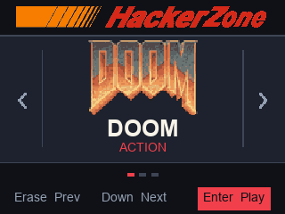
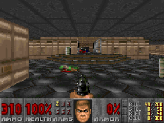

# FixFinder Gamer

Turn a compatible AutoZone FixFinder 5034VSM into a handheld arcade. Play DOOM and other games with the built-in screen, buttons, LEDs, and beeper, or stream the screen and play from a Windows PC over USB.

**[Download firmware](docs/KIT.md#download-compiled-firmware)** · **[Kit quick start](docs/KIT.md)** · **[Start with one scanner](docs/SETUP.md#start-with-one-scanner)** · **[J5 wiring photos](docs/RECOVERY.md#find-the-j5-holes)** · **[Games and controls](docs/PLAY.md)** · **[Developer guide](docs/DEVELOPMENT.md)**

> **If this is your only diagnostic scanner, keep it stock if you still need it for cars.** Installing the arcade replaces factory firmware. There is no dual boot or verified factory restore in this project. You can check the board and build the software before deciding whether to flash.

<table>
  <tr>
    <td rowspan="2" align="center"></td>
    <td align="center"> HackerZone Arcade selector</td>
  </tr>
  <tr>
    <td align="center"> Nuclear Plant, captured over USB</td>
  </tr>
</table>

## What runs on it

| Game or feature | What you get |
| --- | --- |
| **DOOM** | Start with Hangar (E1M1). All nine maps of *Knee-Deep in the Dead* were tested with the matching eMMC pack on the project’s development scanner. The beeper plays cues for weapons, doors, pickups, and damage. |
| **Built-in arcade** | Neon Circuit and Dino Run, a native racer and runner that render at 320 × 240. |
| **USB viewer** | A 320 × 240 Windows preview with keyboard controls. Use the physical controls or the keyboard while the scanner is connected. |
| **USB game loader** | First-time SWD installation, then USB installs of compatible game images with on-device verification. |

## Costs and first steps

You can do the conversion with one compatible scanner. The build tools and DOOM shareware are free. If you already have or can borrow the Windows PC, a Raspberry Pi with a working GPIO header, three jumper leads, a USB data cable, and a screwdriver that fits the case, your equipment cost can be **$0**. Budget time for the build and debug setup, and consider what it would cost to replace your diagnostic tool. [What you need and what it costs](docs/SETUP.md#what-you-need-and-what-it-costs)

1. Confirm the scanner is a USB-C **5034VSM** with a **GD32F427ZK** and PCB marking `PCB_2L_5034_REVC_TYPEC_20200319`. The guide explains how to read its USB ID and which retail Innova models are candidates for a future port. [Identify your scanner](docs/SETUP.md#identify-your-scanner) · [One-scanner decision guide](docs/SETUP.md#start-with-one-scanner)
2. Start with the [one-map arcade build](docs/SETUP.md#build-the-one-map-arcade), which needs no eMMC provisioning. You can prepare both the game and loader on your PC with the scanner unplugged.
3. Run the [read-only SWD checks](docs/RECOVERY.md#check-the-scanner-over-swd) before installing the loader. **Stop if you can’t read factory flash or verify the backup.** Clearing read protection can erase the factory firmware. After the first loader install over SWD, compatible game builds can be installed through the USB data cable.
4. Pick a game with **Erase** or **Down** and launch it with **Enter**. Hold **Down + Back** to return to the selector. [Controls and Windows viewer commands](docs/PLAY.md)

## Explore the project

| Guide | What it covers |
| --- | --- |
| [Installation](docs/SETUP.md) | One-scanner decision guide, equipment costs, build steps, and USB troubleshooting |
| [Play and stream](docs/PLAY.md) | Scanner and keyboard controls, LED behavior, and viewer options |
| [Development](docs/DEVELOPMENT.md) | Source layout, custom games, and tests |
| [Recovery](docs/RECOVERY.md) | J5 photos, read-only factory flash checks, loader installation, and V8 recovery limits |
| [Hardware notes](docs/STATUS.md) | LCD bring-up, board measurements, and hardware verification |
| [Archive](archive) | Earlier USB builds and display experiments |

The game WAD, arcade ROM files, eMMC packs, and generated game images are built locally. See the setup guide for asset sources and the repository’s component notices for attribution.
