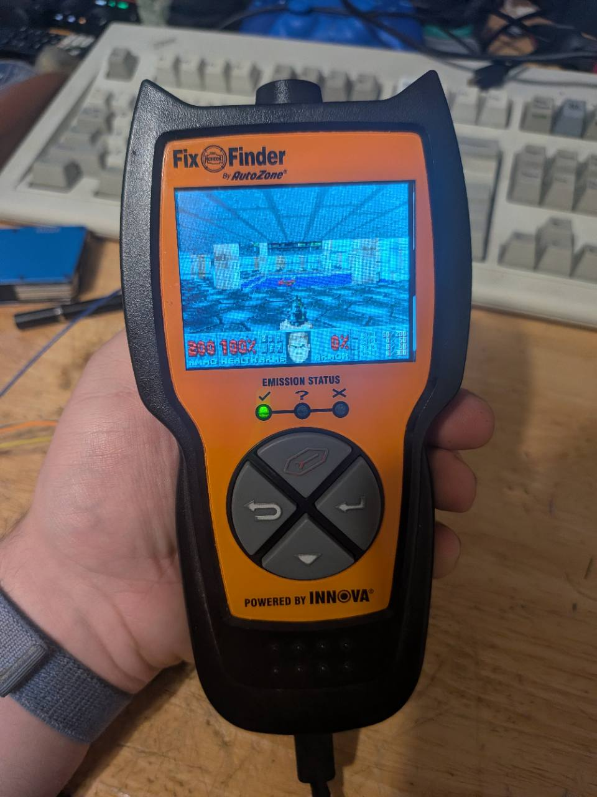
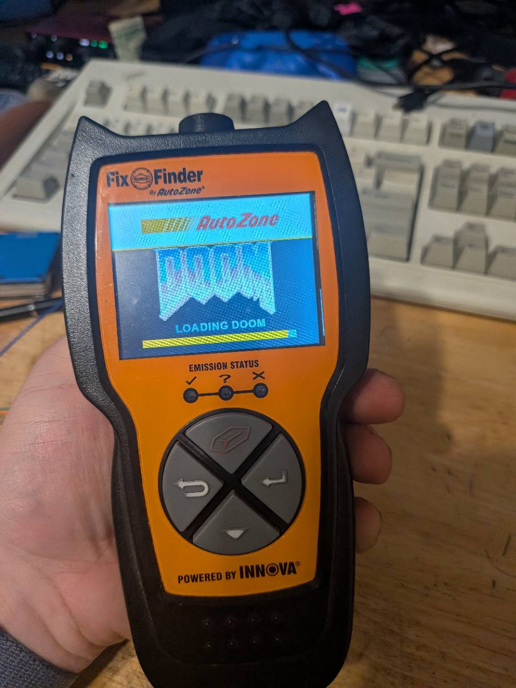

# FixFinder DOOM

Play DOOM E1M1 on a modified AutoZone FixFinder 5034VSM using the built-in LCD, buttons, health LEDs, and beeper. On power-up the resident loader shows the AutoZone and DOOM logos and a progress bar, then starts the game.

| DOOM running on the FixFinder | Startup splash |
| :---: | :---: |
|  |  |

Start with the [installation and recovery guide](docs/SETUP.md). It covers board identification, first-time SWD programming, preparing the game assets, USB installation, and troubleshooting. If the loader and game are already installed, plug in USB and watch the screen from the moment power comes on. The splash lasts about five seconds.

The verified board is marked `PCB_2L_5034_REVC_TYPEC_20200319` and uses a GD32F427ZK. See the [status log](docs/STATUS.md) and [LCD bring-up notes](docs/LCD.md) for the hardware evidence and earlier diagnostics.

## Rebuild V8 on Windows

```powershell
powershell -NoProfile -ExecutionPolicy Bypass -File scripts/Build-V8.ps1
```

The script uses Arm GNU Toolchain 15.2.Rel1 from the existing FixFinder installation. Pass `-ToolchainBin` to select another installation of that release. It compiles from source into a fresh directory under `build/`, emits an ELF, BIN and link map, and requires the BIN to match the [recovery checksum](USB-Build-V8/SHA256SUMS). The original [V8 binary](USB-Build-V8/FixFinder-USB-V8.bin) and ELF are archived with the source and original objects.

## DOOM runtime diagnostic

Use GBADoom revision `25deefdb44427e068735d3ef2af1e9a44d5cac85`. Reduce a local shareware IWAD to E1M1 with the [Prusa reducer](https://github.com/NilsN3DP/Prusa-Core-One._But-Can-it-run-Doom/blob/1b791ccd23d4c95d4eb4a0991ae0192f22730739/tools/reduce_doom.py), then run `GbaWadUtil -in <reduced.wad> -out <converted.wad>` from the pinned GBADoom checkout's `GbaWadUtil` directory. The converted WAD stays under ignored `build/`.

```powershell
powershell -NoProfile -ExecutionPolicy Bypass -File scripts/Build-DoomSwd.ps1 -EngineSource <checkout> -ConvertedWad <converted.wad>
python scripts/Smoke-DoomSwd.py <output-elf>
```

The smoke test uses Python with `unicorn` and `pyelftools`. It enters the linked game runtime after USB setup, supplies a synthetic clock, and exercises E1M1 with simulated movement, firing and release. It also checks all 76,800 RGB565 pixels emitted for a complete 320 x 240 frame. Add `--frame-output <preview.ppm>` to capture that frame.

The linked ELF preserves the V8 USB startup path and keeps counters, an RGB565 frame hash, player coordinates and the last engine error readable over SWD. The display path scales the 240 x 160 indexed frame in TCM to a logical landscape frame through a 640-byte row buffer in AHB SRAM. The default SWD diagnostic consumes rows in software.

The diagnostic takes pressed actions from the `doom_test_buttons` word at the address reported by the current ELF. The [action bits](firmware/doom-swd/input.h) map to movement, turning, strafing, Fire, Use, Menu and Automap. The runtime sends key events on press and release so multiple actions can remain held together. Hold Use with Strafe Left or Right to cycle weapons. Add `--check-weapon-cycle` to verify both chords in emulation.

Add `-CompactReciprocal` to build the smaller diagnostic variant. It replaces the engine's 1 MiB reciprocal lookup table with an equivalent calculation. The regular build is the variant tested on the scanner. The compact build has passed emulation and still needs target timing verification.

`-BoardSource` enables the game build that sends each frame to an initialized landscape HX8347 transport and reads debounced buttons from the same board implementation used by V9. The board must supply measured GPIO mappings, confirm the controller and provide the `read_buttons` callback in [the board interface](firmware/lcd/v9_board.h). The build emits a separate `FixFinder-Doom-Board.elf`. This path has been exercised with a mock board in Cortex-M4 emulation. See the [LCD bring-up notes](docs/LCD.md) for the outstanding hardware checks.

For the experimental 5034VSM with the verified `00 e3 00 00` display response, use `-FixFinderLcd` instead of `-BoardSource`. This builds `FixFinder-Doom-LCD.elf` with the observed 8-bit EXMC wiring, DCS commands, PF7 backlight PWM, and the on-board controls. The SWD input mailbox remains available for diagnostics.

| Scanner buttons | Doom action |
| --- | --- |
| Erase / Down | Walk forward / backward |
| Back / Enter | Turn left / right |
| Back + Enter | Fire |
| Erase + Down | Use doors and switches |
| Down + Back | Menu |
| Down + Enter | Automap |

The LEDs show health. Green is above 50, yellow is 26–50, and red is 25 or lower. The beeper chirps at startup and gives short effects for weapons, pickups, switches, and player damage.

## Swap games over USB on Windows

Scanner 1 has a resident USB loader. It runs before the game and stores one game at a time. With the scanner connected using a USB data cable, run:

```powershell
python scripts/Install-UsbGame.py --serial 676374F50A38 path/to/game.bin
```

The installer uses Windows' built-in HID driver. The tested images in this workspace are `build/usb-games/demo.bin` and `build/usb-games/doom.bin`. A game built with the project USB entry point accepts a reboot request from the installer. If a game hangs or has no USB support, start the command and reconnect the scanner while it waits. The loader lights the LCD and shows a countdown during its five-second USB window. During an install, the bar shows flash write progress and the screen reports verification. The loader stays available when the game image is incomplete or fails verification.

To build your own game, start from [the C display demo](firmware/usb-loader/sample_game.c) and implement `fixfinder_game_run()`. The build provides the USB startup and links the game at `0x08008000`. The demo shows how to start the built-in LCD and send RGB565 pixels. Build and install it with:

```powershell
$demo = ./scripts/Build-UsbLoader.ps1 -GameSource firmware/usb-loader/sample_game.c
python scripts/Install-UsbGame.py --serial 676374F50A38 (Join-Path $demo 'FixFinder-Game.bin')
```

To build the USB version of Doom, add `-FixFinderLcd -CompactReciprocal -UsbGame` to the E1M1 build command above and install the resulting `FixFinder-Doom-LCD-USB.bin`. Games must be compiled for the GD32F427 Cortex-M4 and fit within the 3,040 KiB slot. The resident loader is built by running `Build-UsbLoader.ps1` without arguments. Initial loader installation requires SWD.

The [Wi-Fi bring-up notes](docs/RADIO.md) cover the experimental ESP32 transport. It requires separately programming the radio and verifying its on-board serial link first.

## Multi-map diagnostic

To retain E1M1 through E1M3 from a local DOOM 1.9 shareware IWAD, use the following sequence from the repository root. Run the converter from its own directory with absolute input and output paths, as for the E1M1 build.

```powershell
python scripts/Prepare-SharewareWad.py <doom1.wad> build/shareware-three.wad --maps 3
# Convert build/shareware-three.wad to build/shareware-three-gba.wad with GbaWadUtil.
python scripts/Prepare-SharewareWad.py build/shareware-three-gba.wad build/shareware-three-packed.wad --deduplicate-converted --compact-patches
powershell -NoProfile -ExecutionPolicy Bypass -File scripts/Build-DoomSwd.ps1 -EngineSource <checkout> -ConvertedWad build/shareware-three-packed.wad -CompactReciprocal
python scripts/Smoke-DoomSwd.py <output-elf> --check-progression
```

The progression check triggers each normal level exit directly and uses simulated Fire presses to advance the intermissions. The optional patch compaction shares identical columns within each converted graphic while preserving its dimensions, column order and pixels. The compact three-map board build with the mock driver leaves about 100 KiB of internal flash and was tested in emulation.

For a four-map build, use `--maps 4`, add `--compress-setup` during deduplication, and pass `--last-map 4` to the progression check. This uses a FixFinder-specific WAD format for compressed setup data. The build detects it and decodes one temporary map lump at a time into a 21 KiB TCM buffer. Long-lived map data still stays directly accessible in flash. The four-map mock-board image leaves 5,392 bytes of internal flash. Both builds omit audio, demos and the remaining map data, including the E1M3 secret exit's destination. The nine-map packed WAD alone is larger than the MCU's internal flash.

## Raspberry Pi

The deployment script defaults to uploading and checking the archived V8 image in a private staging directory on `zac@pi`. It requires a trusted host key and batch-mode SSH authentication. `-Inspect` separately reads the CPUID, MCU UID and first two vector words over SWD. The expected V8 vectors are `20020000 08001ca1`. SWD access requires non-interactive sudo on the Pi.

```powershell
powershell -NoProfile -ExecutionPolicy Bypass -File scripts/Deploy-V8.ps1
powershell -NoProfile -ExecutionPolicy Bypass -File scripts/Deploy-V8.ps1 -Inspect
```

Record the full UID in address order after physically identifying the SWD target as the experimental board. For V8 recovery, pass `-Restore -ExpectedUid '<word1> <word2> <word3>'`. The script checks the image hash, CPUID and UID and uses a verified sector download at `0x08000000`. It accepts only the archived V8 binary. Connect the Pi to the experimental scanner only, using SWDIO, SWCLK and ground. Power the scanner separately over USB.
