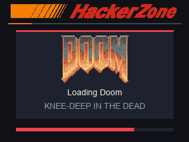
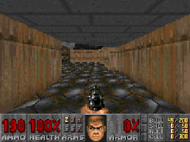

# Play and stream

After boot, the HackerZone Arcade build opens the game selector. **Erase** goes to the previous game, **Down** goes to the next game, and **Enter** launches it. Hold **Down + Back** for about one second to return to the selector. Over USB, use **Up / Down**, **Enter**, and hold **Backspace** to return.

## DOOM controls

| Action | Scanner | PC viewer |
| --- | --- | --- |
| Walk forward / backward | Erase / Down | W / S or Up / Down |
| Turn left / right | Back / Enter | A / D or Left / Right |
| Fire | Back + Enter | Space |
| Open a door or use a switch | Erase + Down | E or Enter |
| Strafe left / right | — | Q / C |
| Open or close menu | Tap Down + Back | Esc |
| Automap | Down + Enter | Tab |
| Return to selector | Hold Down + Back | Hold Backspace |

Hold Erase with Back or Enter to walk forward while turning. In the game menu, Erase and Down move the selection, Back and Enter adjust settings, and Erase + Down confirms. In the automap, Erase + Down toggles follow mode. DOOM starts in Hangar. Advance the results screen with Use to continue. The complete shareware build loads each next map from eMMC, which adds a brief pause.

The green, yellow and red LEDs track health. The built-in beeper plays different pitch patterns for weapon fire, doors, pickups and damage.

| Loading DOOM | Secret level E1M9 |
| --- | --- |
|  |  |

## Other games

| Game | Controls |
| --- | --- |
| DOOM | See the table above. |
| Snake | Use Erase, Down, Back, and Enter to steer up, down, left, and right. |
| Maze Chase | Steer with the same four directions. Collect the dots and use the larger pellets to chase the ghosts. |
| Pong | Use Erase and Down to move your paddle. Play against the scanner. |
| Breakout | Move the paddle with Back and Enter. Clear the bricks before you lose three balls. |
| Neon Circuit | Steer with Back / Enter, boost with Erase, and brake with Down. From the USB viewer, use Left / Right or A / D to steer, Up, W, or Space to boost, and Down / S to brake. Pass the traffic and reach the finish before the timer runs out. |
| Dino Run | Tap any scanner button or press **Space** in the viewer to jump. Clear the cacti as the runner picks up speed. |

**Midway Pac-Man** uses the same directions as Maze Chase. **Enter + Back** or **P** toggles pause. **Erase + Enter** or **R** starts another game.

| Bonus game | Controls |
| --- | --- |
| Dino Run Classic | Press any face button or **Space** to jump. |
| Flight Runner and Danm8ku | Erase, Down, Back, and Enter steer up, down, left, and right. |
| Down 8 | Back and Enter move left and right; Erase jumps. |
| Tick | Press a face button to hit the beat. |
| Cave Explorer | Back and Enter move left and right; Erase acts; Down resets the level. |

The LEDs are off in the selector and yellow while a game loads. During play they show the following states.

| Game | Green | Yellow | Red |
| --- | --- | --- | --- |
| DOOM | Over 50 health | 26–50 health | 25 health or less |
| Pac-Man | Three or more lives | Two lives, starting, or paused | Last life, just lost a life, or game over |
| Snake | Playing or won | Just ate food | Game over |
| Maze Chase | Three lives | Two lives or powered up | Last life or game over |
| Pong | Tied, ahead, or won | Opponent is ahead | Lost the match |
| Breakout | Three balls or won | Two balls | Last ball or game over |
| Neon Circuit | Racing or finished | Off road or under seven seconds left | Collision or time expired |
| Dino Run | Running | Loading | Game over |
| eMMC bonus games | Running | Game sound or waiting for a key | Program stopped |

## Preview the game on a PC

Install the latest DOOM build with `-UsbGame` and keep the scanner connected to Windows through USB. Run the viewer with Python and Tkinter, using [your scanner’s HID serial](SETUP.md#install-or-replace-the-game-over-usb). The default mode streams the full 320 × 240 LCD raster with its RGB palette and compresses suitable strips without losing pixels. Use `--scale 3` for a larger window with sharp pixel edges, `--source` for the lighter 240 × 160 game preview, or `--fast` for the 120 × 80 preview. Older firmware uses its supported uncompressed mode. The USB stream is assembled from strips, so movement can show a seam between strips.

```powershell
python -B scripts/View-FixFinderUsb.py --serial $serial
```

Click the viewer window to give it keyboard focus. In the selector, use **Up / Down** or **W / S** to browse and **Enter** to launch. In arcade games, use the arrow keys or **WASD**. Press **R** to start another Pac-Man game. Hold **Backspace** for one second to return to the selector.

The eMMC bonus games accept simultaneous keys using each game's four-button mapping. **Space** also acts as **Up** in those games, so you can steer and fire in Danm8ku.
