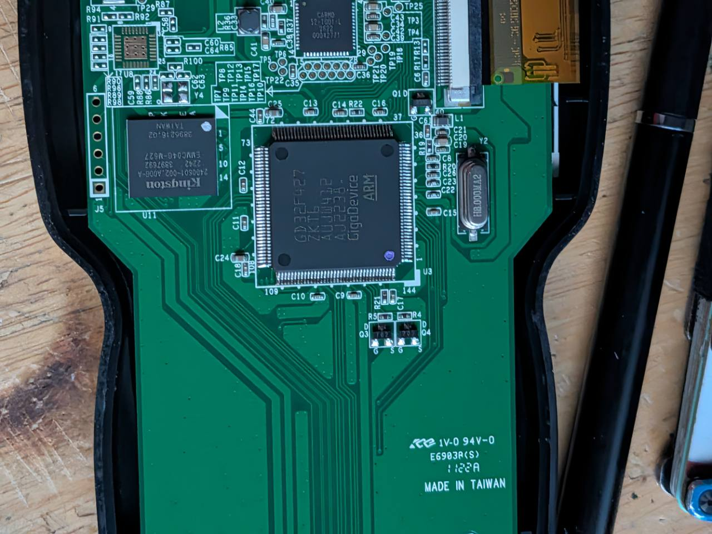
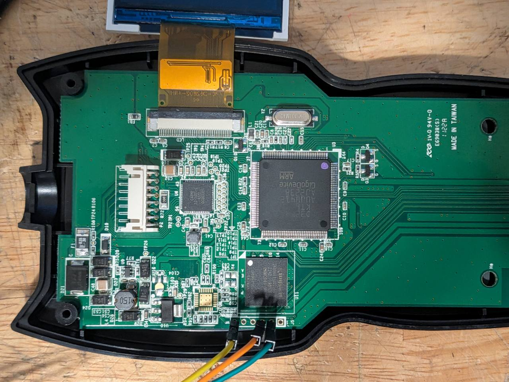

# Recovery and bench tools

If this is your only diagnostic scanner and you still need it for cars, keep the factory firmware. The first loader write replaces the factory boot path. Game installs can overwrite additional factory code. This project does not include a factory firmware image or a verified full return to stock. [Decide whether to convert](SETUP.md#start-with-one-scanner)

## Check the scanner over SWD

Use the scanner you intend to convert. The wiring and `read` commands in this section do not program flash. If the case or board differs from the supported revision, stop and compare the [board markings](SETUP.md) before connecting leads.

Power both devices off to connect the three leads. Find **J5**, the row of six holes along the board edge beside the Kingston chip. Start at **hole 1**, the square pad, and count toward the opposite end. Power the scanner separately through its USB data cable.

### Find the J5 holes

[](photos/265.jpg)

In the bare board photo, J5 is on the left. From top to bottom, the holes are **6 (ground), 5, 4, 3 (SWCLK), 2 (SWDIO), 1 (square pad)**.

[](photos/278.jpg)

In the wired photo, J5 runs left to right along the bottom edge. The yellow lead is on **6 (ground)**, orange is on **3 (SWCLK)**, and teal is on **2 (SWDIO)**. The empty square pad at the right is **1**. Follow the hole numbers if your leads use different colors.

| Scanner J5 | Raspberry Pi physical pin | Signal |
| --- | --- | --- |
| Hole 2 | 18 (GPIO24) | SWDIO |
| Hole 3 | 22 (GPIO25) | SWCLK |
| Hole 6 | 20 | Ground |

Leave J5 holes 1, 4, and 5 unconnected. Use [probe-rs 0.32.0](https://github.com/probe-rs/probe-rs/releases/tag/v0.32.0) on the Pi. Adjust the path in `ffprobe` if you installed it outside `$HOME/.cargo/bin`. If the Pi’s GPIO chip differs from `gpiochip0`, identify the chip with `gpiodetect` and adjust the selector. Power the Pi and scanner separately, then run these commands on the Pi to read the core ID, the board UID, and the flash vectors.

```bash
ffprobe() {
  sudo "$HOME/.cargo/bin/probe-rs" "$@" --chip GD32F427ZK --protocol swd \
    --probe '0:0:gpiochip0,swclk=25,swdio=24' --speed 50
}
ffprobe read b32 0xE000ED00 1 --format simple-hex
ffprobe read b32 0x1FFF7A10 3 --format simple-hex
ffprobe read b32 0x08000000 2 --format simple-hex
```

The expected Cortex-M4 CPUID is `410fc241`. Record the three UID words for this scanner. Seeing a core ID or a UID does not establish that factory flash can be read. If the vectors are unreadable, all zeroes, or erased, or the connection drops between reads, stop before any write. A [factory unit tested by the project](LCD.md#first-continuity-measurements) reported low protection. Clearing that protection causes a main-flash mass erase. [GigaDevice GD32F4xx user manual](https://www.gd32mcu.com/data/documents/userManual/GD32F4xx_User_Manual_Rev3.4.pdf)

### Back up main flash before any write

Read all 3 MiB twice and compare the binary copies. A full read can take several minutes at 50 kHz. The block below prints the backup path and checksum only after both copies match.

```bash
umask 077
backup_dir=$(mktemp -d "$HOME/fixfinder-flash.XXXXXXXX")
(
  set -e
  cd "$backup_dir"
  for copy in first second; do
    ffprobe read b32 0x08000000 786432 --format simple-hex > "$copy.words"
    python3 -c 'import array,pathlib,sys; p=pathlib.Path(sys.argv[1]); a=array.array("I",(int(w,16) for w in p.read_text().split())); assert a.itemsize == 4 and len(a) == 786432; a.byteswap() if sys.byteorder == "big" else None; p.with_suffix(".bin").write_bytes(a.tobytes())' "$copy.words"
  done
  cmp first.bin second.bin
  sha256sum first.bin > SHA256SUMS
  cat SHA256SUMS
  pwd
)
```

If either read fails or the copies disagree, stop. Save the UID, `first.bin`, and `SHA256SUMS` in a private location off the Pi. Verify the copy with `sha256sum -c SHA256SUMS` from the backup directory. Keep it associated with this exact scanner.

The dump covers the MCU’s main flash. It does not capture the MCU option bytes or the separate eMMC and radio storage, and matching dumps do not prove that a factory restore will boot or scan a car. If you need a guaranteed way back to stock, stop here. The [V8 recovery image](#verify-or-restore-the-v8-recovery-baseline) is project firmware and does not restore vehicle diagnostics.

## Install the resident loader once over SWD

Continue only with the unit’s verified backup saved, a stable SWD connection, and a scanner you are willing to dedicate to games. If a tool asks to unlock read protection or erase the whole chip, cancel.

Build the resident loader using the [installation guide](SETUP.md#build-the-resident-loader). Copy `$loaderBin` to your Pi using SCP or another file transfer and compare its SHA-256 with the Windows result. From the folder containing the copied file, recheck the UID and program the loader. Replace the three placeholders with the words you recorded.

```bash
sha256sum FixFinder-USB-Loader.bin
expected_uid='WORD1 WORD2 WORD3'
actual_uid=$(ffprobe read b32 0x1FFF7A10 3 --format simple-hex)
if [ "$actual_uid" = "$expected_uid" ] &&
   [ "$(wc -c < FixFinder-USB-Loader.bin)" -le 16384 ]; then
  ffprobe download FixFinder-USB-Loader.bin --binary-format bin \
    --base-address 0x08000000 --verify && ffprobe reset
else
  printf '%s\n' 'Wrong UID or loader exceeds the first sector.'
fi
```

Use a sector download as shown. If the loader has no valid game yet, the display should settle on **USB LOADER READY**. Return to the [USB game install](SETUP.md#install-or-replace-the-game-over-usb) to load the one-map arcade. The Pi is only needed again for loader changes or SWD recovery.

## Install the combined arcade image over SWD

The combined image writes the loader and built-in arcade in one step. Use it only after the read-only checks and backup pass. It overwrites all touched main-flash sectors through the end of the game. For a scanner that already has the loader, use the combined image or the separate application BIN with the USB installer. [Combined image](../downloads/FixFinder-Arcade-Flash.bin) · [Read-only checks and backup](#check-the-scanner-over-swd) · [USB game installer](SETUP.md#install-or-replace-the-game-over-usb)

Copy `FixFinder-Arcade-Flash.bin` to the Pi and match its SHA-256 to the [published checksum](../downloads/SHA256SUMS). Use the `ffprobe` function from the read-only checks and the three UID words you recorded. If a tool asks to unlock read protection or erase the whole chip, cancel.

```bash
expected_uid='WORD1 WORD2 WORD3'
actual_uid=$(ffprobe read b32 0x1FFF7A10 3 --format simple-hex)
if [ "$actual_uid" = "$expected_uid" ]; then
  ffprobe download FixFinder-Arcade-Flash.bin --binary-format bin \
    --base-address 0x08000000 --verify && ffprobe reset
else
  printf '%s\n' 'Wrong scanner UID.'
fi
```

After reset, the loader briefly shows its boot screen and launches the arcade. Power off both devices before disconnecting the Pi leads. You can then use the scanner over USB.

## Verify or restore the V8 recovery baseline

```powershell
./scripts/Build-V8.ps1
```

The build must match the [archived V8 SHA-256](../USB-Build-V8/SHA256SUMS). V8 is the project's experimental USB baseline. To use the guarded Pi helper, review its SSH user and probe-rs path in [Deploy-V8.ps1](../scripts/Deploy-V8.ps1), then use `-Inspect` and, only for the experimental board, `-Restore -ExpectedUid 'WORD1 WORD2 WORD3'`. It verifies the archived image, core ID and board UID. This procedure restores V8 only; it cannot restore your scanner’s factory firmware.

## Preview through the Pi

Leave the Pi debug leads connected and use the ELF for the exact game build installed on the scanner. Run `arm-none-eabi-nm -S FixFinder-Doom-LCD-USB.elf` and find the addresses of `doom_frame` and `palette`. The frame is 38,400 bytes and the palette is 512 bytes.

Copy `scripts/Preview-FixFinder.py` to the Pi. Run the command below with the Pi's LAN address and the two addresses from your ELF. Substitute your Pi address and the addresses from the matching ELF. Open the private URL printed by the script from your PC on the same network. Stop the preview with Ctrl+C before using the debugger for flashing.

```bash
python3 Preview-FixFinder.py --bind 'PI_LAN_IP' --frame 'FRAME_ADDRESS' --palette 'PALETTE_ADDRESS'
```

The browser refreshes every few seconds. It reads the game framebuffer while DOOM runs, so a capture can include parts of successive frames. The loader splash appears before the game framebuffer is available.
